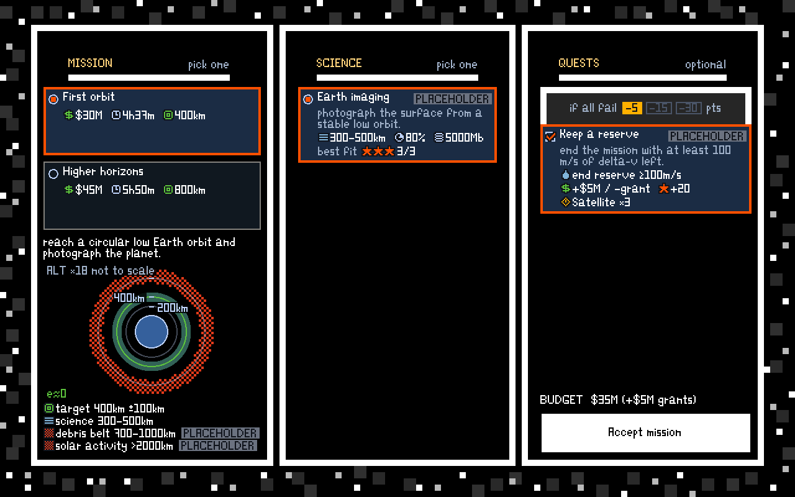
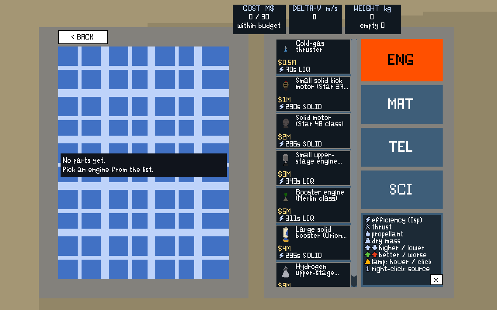
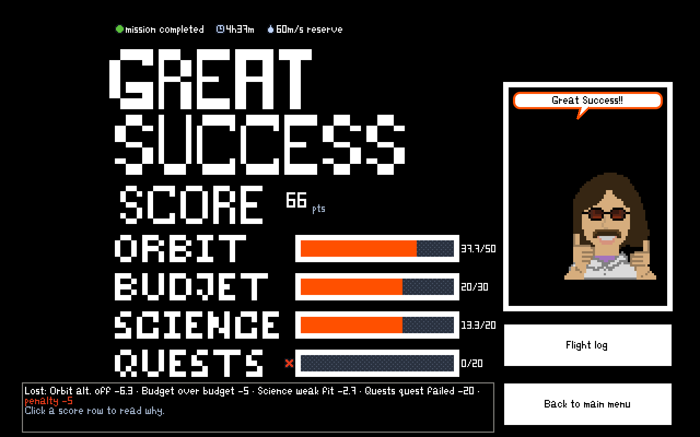

# OrbitOrange

**Design a space mission, build its rocket from real parts, fly it, and see what your trade-offs cost.**

Our entry for the NASA Space Apps Challenge 2026, challenge **"Space Mission Design Game"**. A two-dimensional pixel-art game made with the Godot engine during the hackathon, on 14 and 15 November 2026.

▶ **[Play in the browser](https://ilayla.github.io/OrbitOrange/)**. Nothing to install. A computer with a mouse is best.



## The idea
A real mission is a chain of trade-offs: a better instrument is heavier, a heavier payload needs more fuel, more fuel costs money, and the orbit you can reach decides what science you get. Most learning tools teach one of these at a time. OrbitOrange puts the whole chain in one short game, so that a player feels how each choice limits the next one, and learns as much from a failed mission as from a good one.

## How a game goes
1. **Choose the mission.** Pick a mission (its budget, time and target orbit), the science it should do, and optional quests that pay extra or cost points.
2. **Build the rocket.** Stack stages from 28 parts in four groups: engines, tank materials, telemetry and science instruments. Each part has a cost, a mass and a performance taken or estimated from published figures; right-click a part to read its source. The cost, the delta-v and the weight update as you build, and warning lamps explain what stops a launch.
3. **Plan the flight.** The ascent is computed for you; you choose the launch angle and place engine pulses on a Keplerian orbit to raise, circularise or adjust it.
4. **Fly it.** Watch the mission from a control room at up to 1000× speed. You see only what your telemetry parts can measure. Random events (a satellite conjunction, a debris shower, an unknown asteroid, a solar flare, an engine malfunction, a propellant leak, a sensor failure) can pause the flight and ask for an emergency manoeuvre.
5. **Get scored.** Orbit accuracy, budget, science delivered and quests add up to a score and a result, from Failure to Scientific Breakthrough. Click a score row to read why you lost points.




## NASA data and other sources
The part catalogue, the planet and the orbit mathematics are built on public sources, mostly NASA's. In the game, **Data sources** on the main menu lists them, and each part shows its own source.

- **NASA, CubeSat 101: Basic Concepts and Processes for First-Time CubeSat Developers** (a resource of this challenge): the classes of the science instruments (their numbers are estimates).
- **NASA, State-of-the-Art of Small Spacecraft Technology**: masses and accuracies of sensors, flight computers, magnetometers and cold-gas thrusters.
- **NASA Goddard, General Mission Analysis Tool (GMAT) Mathematical Specifications**: the orbit mathematics.
- **NASA NSSDC, Earth Fact Sheet**: the radius of the Earth.
- **NASA fact sheet "Super Lightweight External Tank"**, NASA's Space Shuttle External Tank figures and **NASA's Composite Cryotank Technologies and Demonstration project**: the tank dry-mass ratios.
- **NASA Apollo documents on the Lunar Module rendezvous radar** (NASA Technical Reports Server): the radar range and mass.
- **NASA Glenn Research Center, "Ideal Rocket Equation" and "Practical Rocketry"**: the propellant mass ratio and the lift-off thrust-to-weight check.

Every source, with its URL, licence and where it is used, is listed in [docs/references/](docs/references/).

## Use of AI
Most of the code was written by AI coding agents (Claude Code and OpenAI Codex), directed, tested and merged by the team. **No image in the game was made by an image-generation model**: the sprites, portraits, mock-ups, logo and font are the team's own drawings. The game has no sound. Each working session, with its tool and model, is recorded in [docs/AI_USAGE.md](docs/AI_USAGE.md).

## Team
Ilay Lazer, Yasha, Stav Yermiyahu, Amit Shoresh and Boris Karlinski. Amit Shoresh drew the game's art.

## Licence
Apache License 2.0; see [LICENSE](LICENSE).

---

## For developers

### Open the project
1. Install **Godot 4.7.2-stable** (the standard build, not the .NET one). Everyone must use this exact version: a newer editor rewrites project files.
2. Clone this repository.
3. Start Godot → **Import** → choose `project.godot` in the cloned folder → **Import & Edit**.
4. Press **F5** to run. The first open takes a moment while Godot builds its cache in `.godot/` (that folder is not committed).

### Where things are
| Folder | What is in it |
|---|---|
| `tasks/` | The work, split into tasks, and `CONTRACTS.md`, which fixes names, units and who owns which file. |
| `context/` | The challenge description, the hackathon rules, the team's notes and `plan_draft.md`, the full design. |
| `design/` | The team's art: screen mock-ups, part sprites, portraits, the logo, the font and button sheets. The game canvas is 640×400. |
| `assets/` | Run-time art built from `design/` by the scripts in `tools/`. |
| `autoload/` | Nodes that exist for the whole game: the catalogue, the game state, the flight, the events. |
| `scripts/` | Game code, by module: `core`, `orbit`, `rocket`, `flight`, `mission`, `design`, `execution`, `events`, `screens`, `ui`. |
| `scenes/` | One scene per screen. |
| `data/` | The catalogue as JSON: parts, missions, celestial bodies, event types. Adding a mission or a part means adding an entry here. |
| `tests/` | Automatic tests, and the screen-capture scenes in `tests/playtest/`. |
| `tools/` | The project check and the scripts that build the part icons, the font and the button skin. |
| `docs/` | The record of AI use and of every external resource, required by the hackathon rules. |

### Check the project
Run this before every commit. It imports the project, runs every test and runs every scene for a moment.

Git Bash:
```bash
tools/check_project.sh
```
PowerShell:
```
tools\check_project.ps1
```
If Godot is not at `C:\dev\Godot\Godot_v4.7.2-stable_win64_console.exe`, set the environment variable `GODOT_EXECUTABLE` to the path of your Godot console executable.

### Web build
Every push to `main` builds the Web export (`export_presets.cfg`) and publishes it on GitHub Pages (`.github/workflows/web-build.yml`).

### Working on it
Read [tasks/README.md](tasks/README.md). In short: one branch per task, edit only the files your task owns, keep the names readable (full words, units written out), and run the check before you push.
